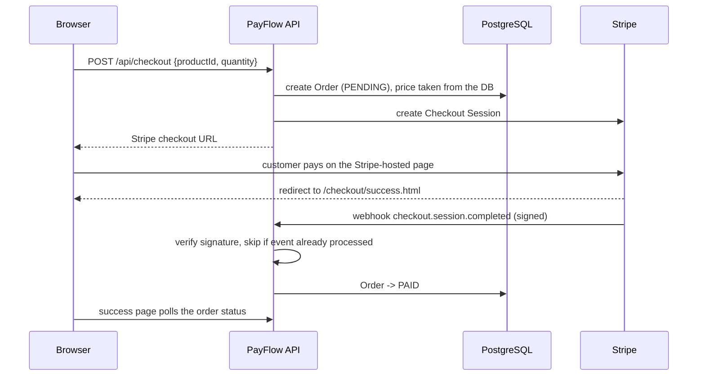

# PayFlow

A small order-and-checkout backend that takes card payments with **Stripe Checkout**
(test mode), built with **Java 21** and **Spring Boot**.

The focus is on getting payments right, not on having many features:
- an order is marked paid **only** after a signature-verified Stripe webhook
- webhook events are processed **exactly once**, even when Stripe delivers them more than once
- refunds use **idempotency keys**, so retrying a request never refunds twice

> **Status: in progress.** Checkout, webhooks and refunds work and have been tested
> by hand against the Stripe sandbox. Automated tests and Docker packaging are being
> added now (see [Roadmap](#roadmap)).

## Tech stack

| Area | Technology |
|------|------------|
| Language / framework | Java 21, Spring Boot 4.2 (Web MVC, Data JPA, Validation) |
| Database | PostgreSQL 16 (Docker Compose) |
| Payments | Stripe Java SDK, Stripe Checkout, Stripe webhooks, Stripe CLI |
| Frontend | One static HTML shop page with plain JavaScript |
| Build | Maven (wrapper included) |

## How a payment works



Order lifecycle: `PENDING` → `PAID` → `REFUNDED`, or `PENDING` → `CANCELLED` when the
checkout session expires.

## Design decisions

- **The webhook is the source of truth.** The success page only *reads* the order
  status. Anyone can open a redirect URL, so it can't be trusted to mark an order paid.
- **Webhook signature verification.** The signature is checked against the raw request
  body. An invalid signature gets `400`.
- **Idempotent event handling.** Each Stripe event id is saved in
  `processed_stripe_events` in the same transaction as the order update, so a
  duplicate delivery is skipped.
- **Defensive checks.** Before marking an order paid, the handler checks that the
  order is `PENDING`, the payment status is `paid` and the amount charged equals the
  order total. Events it can't act on are logged and acknowledged with `200`, so
  Stripe stops retrying them.
- **Prices come from the database, never from the browser.** Money is stored as
  `long` cents, never `double`.
- **Refunds with idempotency keys** (`refund-order-{id}`). The refund endpoint only
  *requests* the refund. The order becomes `REFUNDED` when the `charge.refunded`
  webhook arrives.
- **No DB transaction is held open during a Stripe API call.**
- **The admin endpoint** is protected by a token header, compared in constant time.
- **Secrets come only from environment variables.** None are in the code or the repo.

## API

| Method | Path | Description |
|--------|------|-------------|
| `GET` | `/health` | Health check |
| `GET` | `/api/products` | List products |
| `POST` | `/api/checkout` | Create a `PENDING` order and a Stripe Checkout Session |
| `GET` | `/api/orders/{id}` | Order status |
| `GET` | `/api/orders/by-session/{sessionId}` | Order status by Stripe session id |
| `POST` | `/api/orders/{id}/refund` | Request a full refund (needs the `X-Admin-Token` header) |
| `POST` | `/api/stripe/webhook` | Stripe webhook receiver |

## Running locally

### Prerequisites
- Java 21
- Docker Desktop
- A free [Stripe account](https://dashboard.stripe.com/register) (test mode)
- [Stripe CLI](https://docs.stripe.com/stripe-cli), logged in with `stripe login`

### 1. Configure environment variables

```powershell
Copy-Item .env.example .env
```

Fill in `.env`:

| Variable | Value |
|----------|-------|
| `DB_NAME`, `DB_USER`, `DB_PASSWORD` | Any values; Docker Compose creates the database with them |
| `STRIPE_SECRET_KEY` | Your test key (`sk_test_...`) from the Stripe dashboard |
| `STRIPE_WEBHOOK_SECRET` | Output of `stripe listen --print-secret` |
| `ADMIN_API_TOKEN` | A long random string |
| `APP_BASE_URL` | Optional, defaults to `http://localhost:8080` |

`.env` is gitignored. Never commit real keys.

### 2. Start the database

```powershell
docker compose up -d
```

### 3. Forward Stripe webhooks to your machine

In a separate terminal:

```powershell
stripe listen --events checkout.session.completed,checkout.session.expired,charge.refunded --forward-to localhost:8080/api/stripe/webhook
```

### 4. Start the app

```powershell
.\mvnw.cmd spring-boot:run
```

On macOS or Linux, use `./mvnw spring-boot:run`.

### 5. Try it

1. Open http://localhost:8080 and buy a product.
2. Pay with the Stripe test card `4242 4242 4242 4242`, any future expiry date and any CVC.
3. The success page shows the order changing from `PENDING` to `PAID` once the webhook arrives.
4. Refund the order:

   ```powershell
   Invoke-RestMethod -Method Post -Uri http://localhost:8080/api/orders/1/refund -Headers @{ "X-Admin-Token" = "<your ADMIN_API_TOKEN>" }
   ```

   After the `charge.refunded` webhook arrives, `GET /api/orders/1` shows `REFUNDED`.

## Roadmap

- [x] Products, orders and the order status lifecycle
- [x] Stripe Checkout Session with server-side prices
- [x] Success and cancel pages that read the status from the database
- [x] Webhook with signature verification and idempotent event handling
- [x] Refunds with idempotency keys
- [ ] Automated tests (JUnit 5, MockMvc, Testcontainers PostgreSQL, signed test webhooks)
- [ ] Dockerfile and a full `docker compose up` setup
- [ ] Database migrations (Flyway) to replace `ddl-auto: update`

## Notes

This is a learning and portfolio project. It runs only in Stripe **test mode**, and no
real money is involved.
